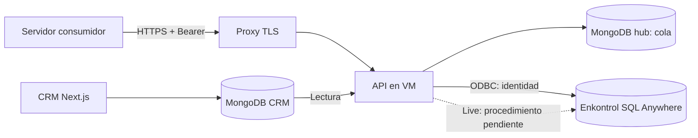

# Arquitectura y alcance

[Índice](README.md)

## Objetivo

Centralizar la conexión entre Enkontrol y diferentes aplicaciones sin acoplar cada aplicación al driver ni al esquema SQL del ERP. La primera entrega cubre el CRM: su base principal continúa siendo MongoDB y su interfaz continúa en Next.js.

La conexión HTTP y el sondeo comparten proceso. El sondeo puede operar sin peticiones entrantes: requiere conectividad saliente a MongoDB y acceso a SQL Anywhere. El CRM no fue modificado para emitir webhooks.

## Componentes y archivos

| Archivo | Responsabilidad |
|---|---|
| `src/main.mjs` | Carga, conexiones Mongo, registro de módulos, lease global, HTTP, ciclo y cierre |
| `src/config.mjs` | Valida configuración y resuelve secretos desde variables |
| `src/http.mjs` | Autenticación, permisos, rutas y respuestas sin datos sensibles de errores |
| `src/crm.mjs` | Proyecciones, elegibilidad, instantáneas y hash estable |
| `src/store.mjs` | Persistencia de trabajos, lease por trabajo y confirmaciones |
| `src/service.mjs` | Captura, sondeo, revalidación y envío |
| `src/erp.mjs` | ODBC, identidad SQL y contrato de procedimiento |

La API no es un proxy SQL genérico. Ningún cliente puede enviar SQL, credenciales Mongo, nombre de colección o procedimiento a través de HTTP. Esos recursos los establece el operador en configuración/código.

## Flujo CRM

1. CRM guarda una etapa elegible, inicialmente `compra`.
2. El sondeo encuentra el lead o un consumidor pide `POST .../sync` sin cuerpo.
3. El módulo lee lead, actividades y visitas; serializa valores y calcula SHA-256.
4. El hub conserva una instantánea pendiente por entidad. Si no cambió el hash, no reemplaza la revisión.
5. En preview se marca `previewHash`; nunca se llama al procedimiento ERP.
6. En live se reclama un trabajo, se vuelve a leer el origen y se verifica su etapa/revisión.
7. Se comprueba servidor, base y archivo de Enkontrol. El procedimiento recibe parámetros, no SQL construido con datos del lead.
8. Tras una respuesta con `erp_id`, el hub registra el hash entregado. Ante fallo conserva el trabajo para reintentar.

## Decisiones

- **Base hub separada:** permite usar permisos de lectura en MongoDB del CRM. El estado de envío no se añade al documento del lead.
- **Módulos explícitos:** una conexión Mongo adicional no implica que su esquema sea compatible con CRM.
- **Sondeo:** no exige change streams ni transacciones en el CRM, pero puede perder transiciones intermedias.
- **Un proceso activo por hub:** lease global y mutex por aplicación. No desplegar múltiples réplicas como mecanismo de escalado.
- **Modo global:** `SYNC_MODE` y la identidad de Enkontrol son compartidos por todas las apps. No hay un ERP o un modo distinto por aplicación.
- **Entrega al menos una vez:** la confirmación SQL y la confirmación Mongo no comparten transacción. La deduplicación debe existir en el ERP.

## Fuera del alcance actual

Sin interfaz administrativa, OAuth, CORS configurado, rotación de claves sin reinicio, registro dinámico de apps, webhooks, streaming, métricas Prometheus, histórico completo de eventos, archivado automático o sincronización inversa. El visor en tiempo real y el portal de proveedores requieren desarrollo posterior.

## Límites que afectan al diseño

La identidad `test_ck` coincide con el servicio de pruebas indicado por el usuario, pero no prueba por sí sola el aislamiento de producción. La base observada fue `EK_ADM01_11`; falta confirmar el archivo exacto con TI.

El hash identifica contenido, no un evento único. Una secuencia A → B → A puede reutilizar una clave de idempotencia antigua; antes de live se debe definir una revisión monotónica/evento si el negocio necesita reaplicar A. Tampoco se garantiza orden transaccional entre cambios del CRM y la escritura ERP. Ver [aceptación](testing.md).
